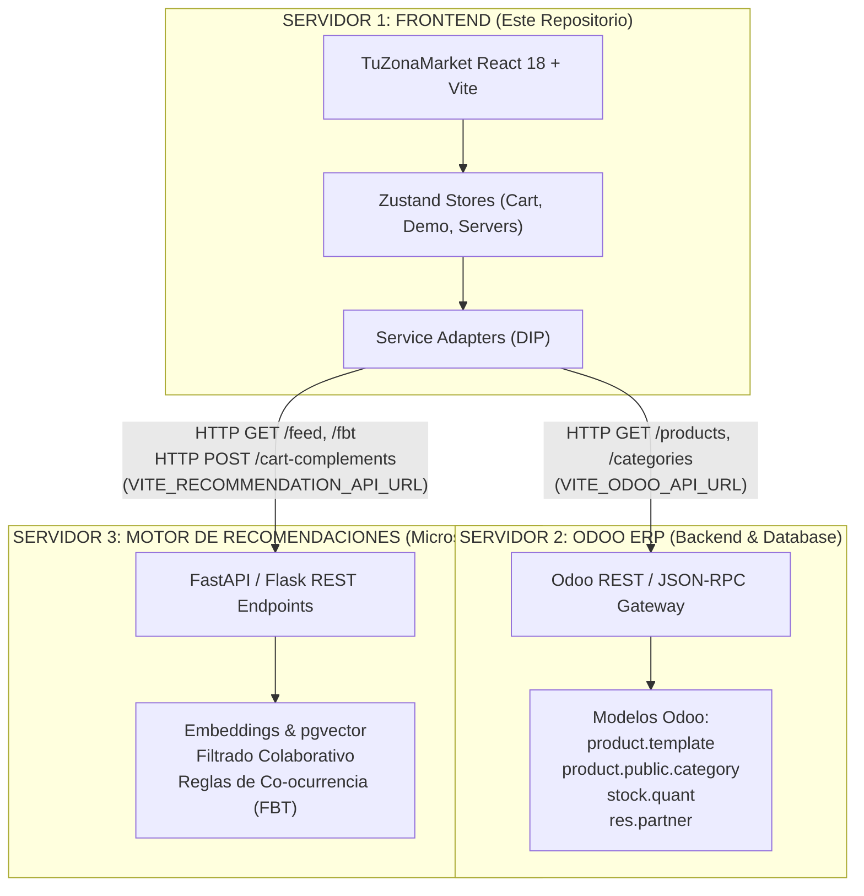

# Arquitectura Distribuida: TuZonaMarket Frontend (Odoo ERP + Motor de Recomendaciones Externo)

---

## 1. Topología de Tres Servidores Desacoplados

Este repositorio contiene **únicamente la capa Frontend / Cliente Web** de TuZonaMarket. La solución global está distribuida en tres servidores independientes que se comunican a través de APIs REST/JSON:



---

## 2. Inversión de Dependencias (DIP) y Contratos de Servicio

La interfaz gráfica no posee ninguna dependencia directa hacia la lógica interna de Odoo ni del recomendador. Consume interfaces abstractas:

### A. Contrato Odoo ERP (`src/types/odoo.ts` ➔ `src/services/odooService.ts`)
```typescript
export interface IOdooService {
  getProducts(params?: { category?: string; search?: string; limit?: number; offset?: number }): Promise<Product[]>;
  getProductById(id: string): Promise<Product | null>;
  getCategories(): Promise<{ id: string; name: string; icon?: string }[]>;
  getBranches(): Promise<Branch[]>;
  checkHealth(): Promise<{ online: boolean; message: string; latencyMs?: number }>;
}
```

### B. Contrato del Motor de Recomendaciones Externo (`src/types/recommendations.ts` ➔ `src/services/remoteRecommendationService.ts`)
```typescript
export interface IRecommendationService {
  getPersonalizedHomeFeed(userId: string, limit?: number): Promise<RecommendedProduct[]>;
  getFrequentlyBoughtTogether(productId: string): Promise<RecommendedProduct[]>;
  getSimilarAlternatives(productId: string, limit?: number): Promise<RecommendedProduct[]>;
  getCartComplements(cartProductIds: string[]): Promise<RecommendedProduct[]>;
}
```

---

## 3. Especificación de Endpoints del Motor de Recomendaciones Externo (Servidor 3)

El servidor externo de recomendaciones debe exponer las siguientes rutas REST:

1. **Personalized Home Feed:**
   - `GET /api/v1/feed?user_id={userId}&limit={limit}`
   - *Respuesta:* Lista de `RecommendedProduct` con score de afinidad y algoritmo aplicado.
2. **Frequently Bought Together (Slot 2 PDP):**
   - `GET /api/v1/frequently-bought-together?product_id={productId}`
   - *Respuesta:* Productos frecuentemente agregados en la misma orden para el combo de descuento.
3. **Cart Complements (Slot 3 Slide-over):**
   - `POST /api/v1/cart-complements`
   - *Cuerpo:* `{ "product_ids": ["prod-001", "prod-008"] }`
   - *Respuesta:* Artículos de complementariedad o cross-sell para el carrito.
4. **Health Check:**
   - `GET /api/v1/health` ➔ `{ "status": "ok", "service": "recommendations_pgvector" }`

---

## 4. Especificación de Endpoints de Odoo ERP (Servidor 2)

El backend de Odoo debe exponer o enrutar:

1. **Catálogo de Productos:**
   - `GET /api/products?category={cat}&search={q}&limit={n}&offset={n}`
   - *Modelos Odoo asociados:* `product.template`, `product.product`, `product.pricelist`.
2. **Detalle de Producto:**
   - `GET /api/products/{id}`
3. **Categorías:**
   - `GET /api/categories` ➔ Modelos `product.public.category`.
4. **Sucursales / Almacenes:**
   - `GET /api/branches` ➔ Modelos `stock.warehouse`.
5. **Health Check:**
   - `GET /api/health` ➔ `{ "status": "ok", "odoo_version": "17.0" }`

---

## 5. Variables de Entorno (`.env`)

```env
# Servidor 2: Odoo ERP
VITE_ODOO_API_URL=https://odoo.tuzonamarket.com/api
VITE_ODOO_DB=tuzonamarket_prod
VITE_ODOO_API_KEY=tu_token_de_odoo

# Servidor 3: Motor de Recomendaciones Externo
VITE_RECOMMENDATION_API_URL=https://recs.tuzonamarket.com/api/v1

# Configuración de Moneda Local
VITE_EXCHANGE_RATE_VES=46.50
```

---

## 6. Panel de Diagnóstico y Telemetría en Vivo (`<RecommendationDebugger />`)

El widget flotante en la esquina inferior izquierda permite:
- **Pestaña "Conexión Servidores":** Probar el ping (health check) en tiempo real tanto de Odoo como del Motor de Recomendaciones e ingresar las URLs de los servidores en caliente sin reiniciar la app.
- **Pestaña "Perfiles":** Alternar entre los perfiles de usuario para validar el comportamiento del recomendador ante diferentes vectores de compra.
- **Pestaña "Ajustes":** Activar/desactivar badges de explicabilidad y simular latencia de red.
