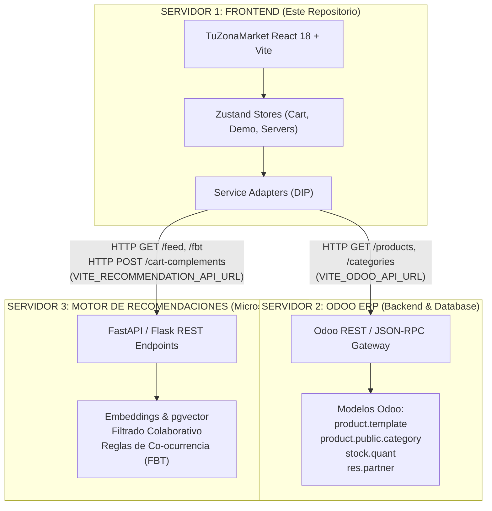

# Arquitectura Distribuida: TuZonaMarket Frontend (Odoo ERP + Motor de Recomendaciones Externo)

---

## 1. Topología de Tres Servidores Desacoplados

Este repositorio contiene **únicamente la capa Frontend / Cliente Web** de TuZonaMarket. La solución global está distribuida en tres servidores independientes que se comunican a través de APIs REST/JSON:

## 2. Inversión de Dependencias (DIP) y Contratos de Servicio

La interfaz gráfica no posee ninguna dependencia directa hacia la lógica interna de Odoo ni del recomendador. Consume interfaces abstractas:

- `IOdooService` (`src/types/odoo.ts`)
- `IRecommendationService` (`src/types/recommendations.ts`)
